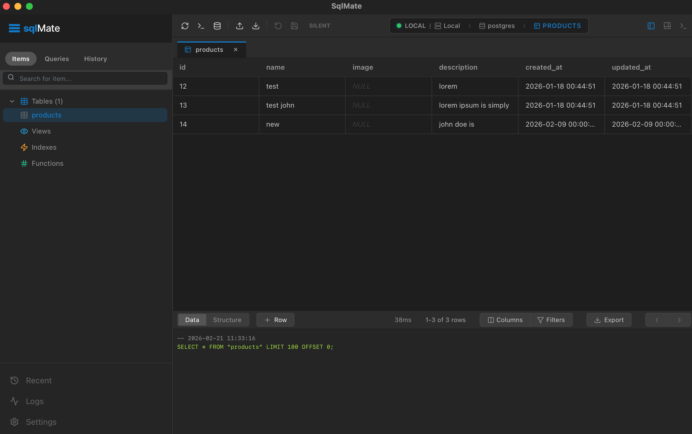
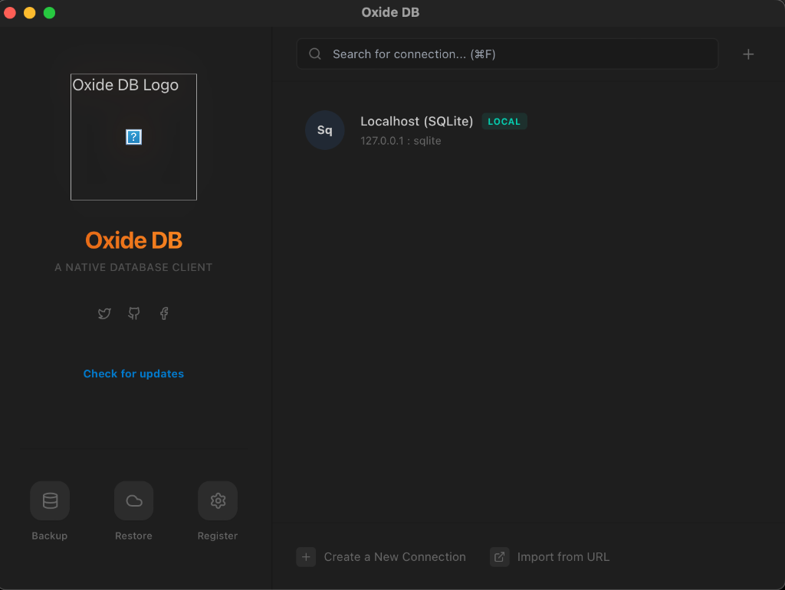
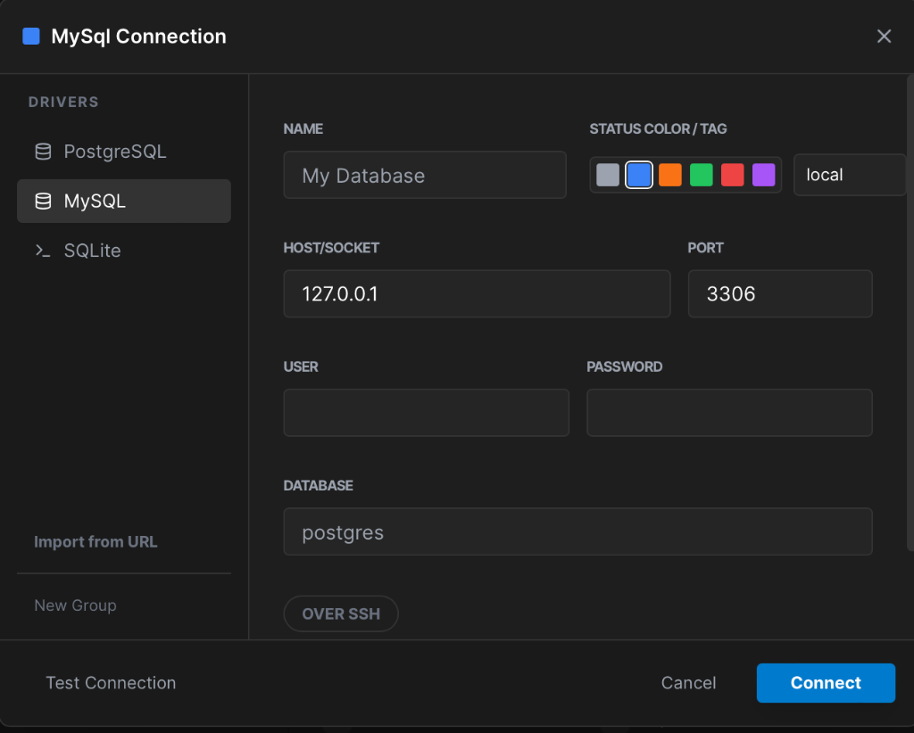
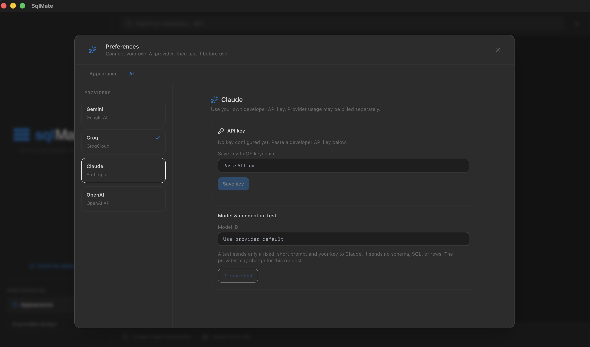

<p align="center">
  <a href="https://sqlmate.io">
    
  </a>
</p>

## Screenshots

<p align="center">
  
  <br />
  <em>The modern, clean workspace in SqlMate</em>
</p>

<p align="center">
  
  
  <br />
  <em>Welcome screen and connection management</em>
</p>

<p align="center">
  
  <br />
  <em>Connect your own AI provider, then test it before use</em>
</p>

> [!TIP]
> **Capturing High-Quality Screenshots**: To avoid blurriness, capture screenshots on a Retina display (MacBooks) using `Cmd + Shift + 4`, then `Space` to select the window. This saves a high-DPI image. The README is configured to display these at half-width for maximum sharpness.

## Features

- **Multi-Database Support**: Connect to PostgreSQL, MySQL, SQLite, and local DuckDB files.
- **DuckDB (read-only preview)**: Open an existing `.duckdb` file, browse tables and views, run one bounded `SELECT` at a time, and profile a bounded table sample. DuckDB connections cannot edit data, import or export tables, compare databases, or use the relationship map yet; external file access from SQL and extension autoloading are disabled.
- **AI Assistant**: Generate, explain, and fix SQL with your own Gemini, Groq, Claude, or OpenAI API key. Review the outbound request and proposed SQL before use.
- **Modern Sidebar Experience**:
  - **Items**: Explore your databases, schemas, and tables.
  - **Queries**: Manage your saved SQL scripts.
  - **History**: A persistent, searchable log of all executed queries, grouped by date.
- **Advanced Query History**:
  - **Automatic Tracking**: Every query executed (manually or via table browsing) is recorded.
  - **Date Grouping**: Queries are logically grouped by day with collapsible sections.
  - **Search & Filter**: Quickly find past queries using the integrated search.
  - **Replay**: Instant replay of any historical query into a new editor tab.
- **Unified Quick Open**: Press `Cmd+P` on macOS or `Ctrl+P` on Windows to find open connections, databases, tables, tabs, saved SQL, and recent history. Opening a query fills an editor for review; it never runs automatically.
- **Persistence**: Your connection settings and query history are saved locally for a seamless experience across restarts.
- **Unsaved SQL Protection**: Modified query tabs show a dot and offer to save a library copy before closing. Use `Cmd/Ctrl+W` to close the active tab and `Cmd/Ctrl+Shift+T` to reopen a recently closed tab in the current database during the same session.
- **Connection Removal Review**: Deleting a saved connection requires confirmation and review of unsaved SQL. It removes the profile and stored credentials, not the database or local database file.
- **SSH Host Verification**: Verify the server's SHA256 host key fingerprint before SqlMate authenticates. A changed key blocks the connection until it is verified again.
- **Native Performance**: Leverages Rust for backend operations and Tauri for a smooth desktop experience.
- **Sensitive Data Guard**: Likely secret columns are masked in table and query results. Hold the eye control to reveal one value, or use a column's eye toggle to correct a classification or mask an alias. Raw copying and potentially sensitive table exports require confirmation.
- **Export Query Results**: Use **Export Results** in the SQL result pane to save selected or all loaded rows as CSV or JSON without rerunning the query. The dialog flags capped results, and files redact likely-sensitive and manually masked columns even if revealed in the grid. Exports are limited to 32 MiB per file.
- **Query Result Charts**: Open **Chart** in the SQL result pane to plot a numeric column as bars or a line. Choose an X label or use row numbers. Charts use the first 200 loaded rows in result order, skip nonnumeric values, and exclude sensitive and manually masked columns. No query is rerun.
- **Cell Value Inspector**: Press `Space` on a focused table or query-result cell, or choose **Inspect value** from its context menu, to read the full value and explore searchable JSON. Large or deeply nested values remain available as raw text. Sensitive values stay hidden by default; persistent reveal and raw copying require separate confirmations.
- **Connection-Aware Write Protection**: New writable connections default to **Confirm queries & writes**. Review the target and SQL before execution. **Read-only** allows one read-only `SELECT` at a time and blocks row edits and other writes; use a read-only database account for stronger protection. **No confirmation** runs operations without an approval prompt.
- **Query Plan Inspector**: Explain the selected or cursor `SELECT` without executing it. Inspect estimated plan steps or raw output for PostgreSQL, MySQL/MariaDB, and SQLite. `EXPLAIN ANALYZE` is intentionally unavailable.
- **Foreign-Key Navigation**: Follow declared references from table cells into a separate, browse-only filtered tab, then return to the source. Composite keys are supported; masked source values must be revealed before following.
- **Schema-Aware PostgreSQL Browsing**: Search and open `schema.table` directly. Same-named tables stay distinct in tabs, relationships, metadata, edits, and exports.
- **Read-Only Schema Compare**: Compare open same-engine connections to spot table and column drift. Review types, nullability, defaults, and primary keys side by side without reading rows or applying migrations.
- **Read-Only Data Compare**: Compare up to 200 primary-key-ordered rows per side across open same-engine connections. For a single-column integer primary key, set an inclusive lower bound, upper bound, or both to compare a specific range. Incomplete samples are marked as unchecked, and sensitive values stay masked.
- **Relationship Map**: Explore a table's declared foreign-key links to nearby tables in a read-only, pannable diagram. Follow a linked table without loading database rows into the map.

## Getting Started

### Prerequisites

- [Node.js](https://nodejs.org/)
- [Rust](https://www.rust-lang.org/)
- [Tauri Dependencies](https://tauri.app/v1/guides/getting-started/prerequisites)

### Installation

1. Clone the repository:
   ```bash
   git clone https://github.com/Nitish27/sqlMate.git
   cd sqlMate
   ```

2. Install dependencies:
   ```bash
   npm install
   ```

3. Run in development mode:
   ```bash
   npm run tauri dev
   ```

### SSH Connections

In the connection editor, enable SSH, enter the host and port, and choose **Check fingerprint**. The check does not send SSH credentials. Ask your server administrator for the SHA256 fingerprint of the server's host key over a trusted channel. Enter that fingerprint, choose **Trust matching fingerprint**, then **Save & Connect**. **Test Connection** does not save the fingerprint.

Existing SSH connections need this one-time review. SqlMate stores the trusted fingerprint per connection and does not import your OpenSSH `known_hosts` file. If a key changes, confirm the reason and new fingerprint with your administrator before replacing it. If you cannot confirm it, do not connect.

### AI Assistant

Open **Preferences > AI** from the sidebar, welcome screen, or SQL assistant. Choose Gemini, Groq, Claude, or OpenAI, save your own developer API key in the OS keychain, and use **Prepare test** to review a small outbound request before sending it. A successful test lets you make that provider and model the default. API usage may incur charges separate from a consumer-app subscription.

For advanced local setup, `GEMINI_API_KEY`, `GROQ_API_KEY`, `ANTHROPIC_API_KEY`, and `OPENAI_API_KEY` remain supported in `.env` (see [.env.example](.env.example)); `YOUR_GROQ_API_KEY` is also accepted. A key saved in the app takes precedence over an environment key. An installed app does not read the repository's `.env`: put a per-user `.env` in the app config directory instead (on macOS, `~/Library/Application Support/com.sqlmate.db/.env`) and restart. `SQLMATE_AI_PROVIDER` sets the default only until one is saved in Preferences. Never bundle or commit an API key.

Generate, Explain, and Fix always show the exact request body and destination for review before sending. They may send selected schema metadata, SQL, errors, or text you entered, but not database rows or connection credentials. Proposed SQL is never run automatically. AI is disabled by default for connections tagged `production` until explicitly enabled for that connection.

For moderated connection testing, use the [disposable database fixture and session script](usability/README.md).

For automated PostgreSQL and MariaDB release checks, use the [cross-engine smoke gate](smoke/README.md).

## Tech Stack

- **Frontend**: React, TypeScript, Tailwind CSS, Monaco Editor, Lucide Icons.
- **Backend**: Rust (`sqlx` for PostgreSQL, MySQL, and SQLite; `duckdb` for local DuckDB files).
- **Framework**: [Tauri](https://tauri.app/).

## Recommended IDE Setup

- [VS Code](https://code.visualstudio.com/) + [Tauri](https://marketplace.visualstudio.com/items?itemName=tauri-apps.tauri-vscode) + [rust-analyzer](https://marketplace.visualstudio.com/items?itemName=rust-lang.rust-analyzer)

## Distribution

- Windows installers (NSIS `.exe` + MSI) via GitHub Actions: [docs/windows-distribution.md](docs/windows-distribution.md)
- macOS signing and notarization workflow: [docs/macos-distribution.md](docs/macos-distribution.md)
- In-app updates through GitHub Releases: [docs/updates.md](docs/updates.md)
- Automatic Hostinger website downloads after release publication: [docs/hostinger-downloads.md](docs/hostinger-downloads.md)
- Mac App Store scaffolding and upload flow: [docs/mac-app-store.md](docs/mac-app-store.md)

Pushing a `v*` tag builds signed macOS bundles, Windows installers, and updater artifacts and attaches them to a single GitHub release draft.
