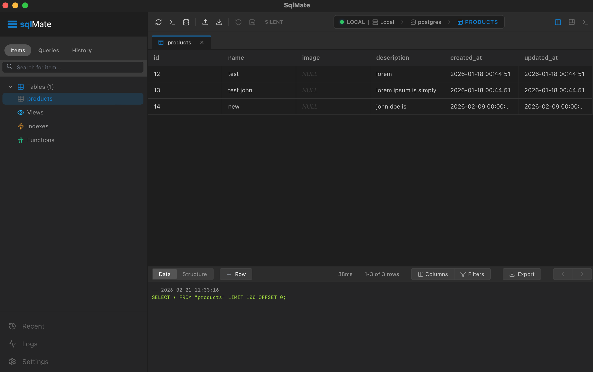
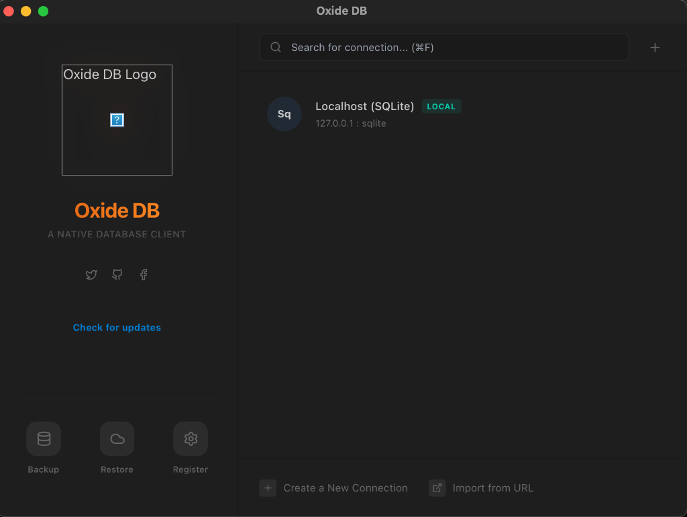
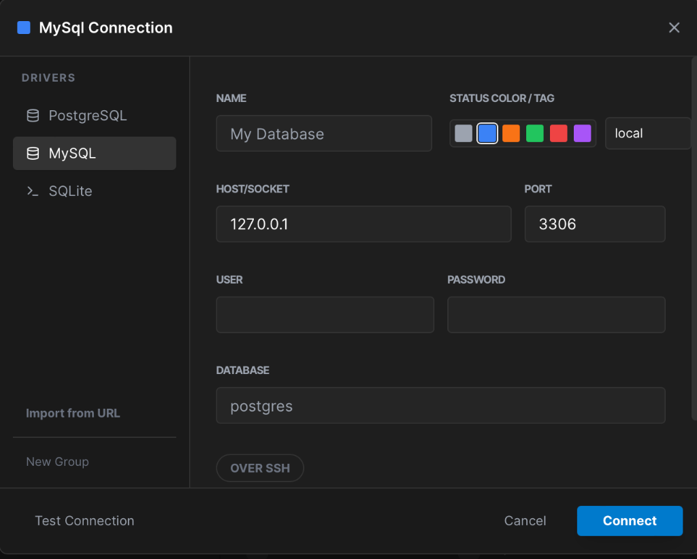
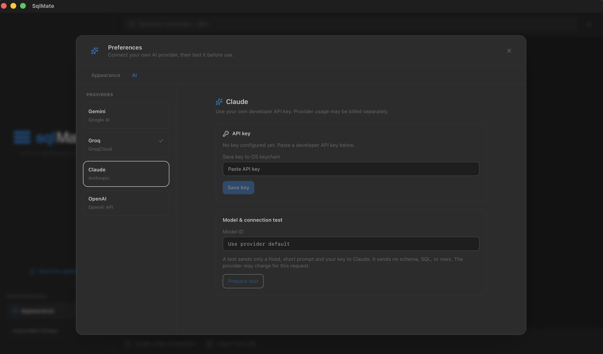

<p align="center">
  <a href="https://sqlmate.io">
    
  </a>
</p>

## Screenshots

<p align="center">
  
  <br />
  <em>The modern, clean workspace in SqlMate</em>
</p>

<p align="center">
  
  
  <br />
  <em>Welcome screen and connection management</em>
</p>

<p align="center">
  
  <br />
  <em>Generate SQL using natural language with the integrated AI assistant</em>
</p>

> [!TIP]
> **Capturing High-Quality Screenshots**: To avoid blurriness, capture screenshots on a Retina display (MacBooks) using `Cmd + Shift + 4`, then `Space` to select the window. This saves a high-DPI image. The README is configured to display these at half-width for maximum sharpness.

## Features

- **Multi-Database Support**: Connect to PostgreSQL, MySQL, and SQLite.
- **AI-Powered Text-to-SQL**: Generate SQL from natural language with Gemini or Groq, then review it before running.
- **Modern Sidebar Experience**:
  - **Items**: Explore your databases, schemas, and tables.
  - **Queries**: Manage your saved SQL scripts.
  - **History**: A persistent, searchable log of all executed queries, grouped by date.
- **Advanced Query History**:
  - **Automatic Tracking**: Every query executed (manually or via table browsing) is recorded.
  - **Date Grouping**: Queries are logically grouped by day with collapsible sections.
  - **Search & Filter**: Quickly find past queries using the integrated search.
  - **Replay**: Instant replay of any historical query into a new editor tab.
- **Persistence**: Your connection settings and query history are saved locally for a seamless experience across restarts.
- **Native Performance**: Leverages Rust for backend operations and Tauri for a smooth desktop experience.
- **Sensitive Data Guard**: Likely secret columns are masked in table and query results. Hold the eye control to reveal one value, or use a column's eye toggle to correct a classification or mask an alias. Copying sensitive rows and exporting potentially sensitive data require explicit confirmation.
- **Connection-Aware Safe Mode**: Browse tables and run one `SELECT` statement at a time through a read-only database context. Row edits and other writes remain blocked. Use a read-only database account for stronger protection, especially against side effects in database functions.
- **Query Plan Inspector**: Explain the selected or cursor `SELECT` without executing it. Inspect estimated plan steps or raw output for PostgreSQL, MySQL/MariaDB, and SQLite. `EXPLAIN ANALYZE` is intentionally unavailable.

## Getting Started

### Prerequisites

- [Node.js](https://nodejs.org/)
- [Rust](https://www.rust-lang.org/)
- [Tauri Dependencies](https://tauri.app/v1/guides/getting-started/prerequisites)

### Installation

1. Clone the repository:
   ```bash
   git clone https://github.com/Nitish27/sqlMate.git
   cd sqlMate
   ```

2. Install dependencies:
   ```bash
   npm install
   ```

3. Run in development mode:
   ```bash
   npm run tauri dev
   ```

### Text to SQL

Set `GEMINI_API_KEY` or `GROQ_API_KEY` in your local `.env` (see [.env.example](.env.example)), then restart SqlMate. Existing `YOUR_GROQ_API_KEY` values are also accepted. If both keys are present, Gemini is used by default; set `SQLMATE_AI_PROVIDER=groq` or `gemini` to choose explicitly.

An installed app does not read the repository's `.env`. Put a per-user `.env` in the app config directory instead (on macOS, `~/Library/Application Support/com.sqlmate.db/.env`); the Text to SQL panel shows the exact expected path if no key is found. Never bundle or commit an API key. Text to SQL sends your request and relevant table/column metadata to the selected provider, but not database rows or connection credentials. It inserts generated SQL into the editor; it does not execute it. Provider usage may incur charges.

For moderated connection testing, use the [disposable database fixture and session script](usability/README.md).

For automated PostgreSQL and MariaDB release checks, use the [cross-engine smoke gate](smoke/README.md).

## Tech Stack

- **Frontend**: React, TypeScript, Tailwind CSS, Monaco Editor, Lucide Icons.
- **Backend**: Rust (using `sqlx` for database interactions).
- **Framework**: [Tauri](https://tauri.app/).

## Recommended IDE Setup

- [VS Code](https://code.visualstudio.com/) + [Tauri](https://marketplace.visualstudio.com/items?itemName=tauri-apps.tauri-vscode) + [rust-analyzer](https://marketplace.visualstudio.com/items?itemName=rust-lang.rust-analyzer)

## Distribution

- Windows installers (NSIS `.exe` + MSI) via GitHub Actions: [docs/windows-distribution.md](docs/windows-distribution.md)
- macOS signing and notarization workflow: [docs/macos-distribution.md](docs/macos-distribution.md)
- In-app updates through GitHub Releases: [docs/updates.md](docs/updates.md)
- Mac App Store scaffolding and upload flow: [docs/mac-app-store.md](docs/mac-app-store.md)

Pushing a `v*` tag builds signed macOS bundles, Windows installers, and updater artifacts and attaches them to a single GitHub release draft.
